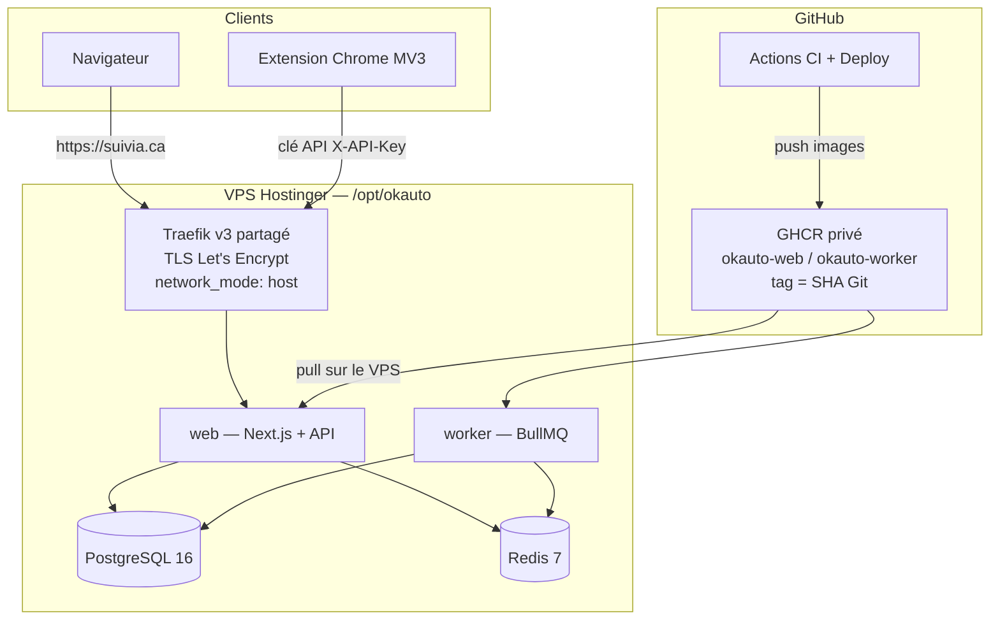

# Suivia Auto

**Site en production :** [https://suivia.ca](https://suivia.ca) (`www.suivia.ca` redirige vers l’apex).

Suivia Auto est un **centre de publication automobile**. Il synchronise l’inventaire d’une concession, prépare les annonces Facebook Marketplace, et suit chaque publication jusqu’à la vente. La publication elle-même reste humaine : l’équipe vérifie et clique **Publier** dans Facebook.

Ce fichier s’adresse d’abord à **Michael** (propriétaire, sans jargon), puis aux développeurs qui reprennent le dépôt. Les noms internes (`okauto`, `@okauto/*`, `/opt/okauto`) sont historiques : le produit s’appelle **Suivia Auto**. On n’écrit jamais « SuiviaAuto » ; le mot-symbole est **SUIVIA AUTO** (deux mots).

---

## Table des matières

1. [Pour Michael](#1-pour-michael)
2. [Ce que fait Suivia, et pour qui](#2-ce-que-fait-suivia-et-pour-qui)
3. [Fonctionnalités](#3-fonctionnalités)
4. [Architecture](#4-architecture)
5. [Démarrage local](#5-démarrage-local)
6. [Variables d’environnement](#6-variables-denvironnement)
7. [Tests et CI](#7-tests-et-ci)
8. [Déploiement](#8-déploiement)
9. [Extension Chrome](#9-extension-chrome)
10. [Sauvegardes et surveillance](#10-sauvegardes-et-surveillance)
11. [Dépannage et FAQ](#11-dépannage-et-faq)
12. [Documentation plus détaillée](#12-documentation-plus-détaillée)
13. [Licence et noms historiques](#13-licence-et-noms-historiques)

---

## 1. Pour Michael

Vous n’avez pas besoin de compiler le projet au quotidien. Le site en ligne, c’est [suivia.ca](https://suivia.ca).

### Routine du matin

Le détail pas à pas est dans [`GUIDE_DEMARRAGE.md`](GUIDE_DEMARRAGE.md). En résumé :

1. Ouvrir **Vue du matin** et confirmer que la synchro (ex. BuckinghamGM en local) est « Opérationnelle ».
2. Traiter d’abord **Publications → À retirer** (véhicules vendus encore en ligne).
3. Dans **À préparer**, chercher un stock, un NIV, une marque ou un modèle, puis **Publier**.
4. Vérifier prix, kilométrage, stock, NIV et photo.
5. **Publier sur Marketplace** : avec l’extension Chrome, Facebook s’ouvre déjà préparé ; sans l’extension, Suivia copie le texte et télécharge la photo.
6. Vérifier l’annonce dans Facebook, puis cliquer **Publier** (c’est vous qui validez).
7. Après publication, copier l’URL `/marketplace/item/…` et **Marquer comme publiée** dans Suivia si l’extension ne l’a pas déjà enregistrée.
8. Quand un véhicule disparaît du flux, il arrive dans **À retirer**. Retirer l’annonce sur Facebook, puis confirmer dans Suivia.

Suivia **prépare et suit**. La validation et le clic final restent humains. On ne contourne ni CAPTCHA, ni connexion Facebook, ni limites de Meta.

### Demandes d’accès

L’inscription publique est **fermée**. Un visiteur clique « Créer mon espace » et remplit [Demander un accès](https://suivia.ca/demande-acces). Aucun compte n’est créé automatiquement.

Seuls les **administrateurs de la plateforme** voient le menu **Demandes d’accès**. Ce n’est pas le rôle Propriétaire d’une concession. La liste est contrôlée par la variable `PLATFORM_ADMIN_USER_IDS` sur le serveur (identifiants internes `users.id`, pas des courriels). Si elle est vide, **personne** ne voit les demandes.

### Déployer une mise à jour

1. Un développeur fusionne sur `main`. La CI tourne.
2. Dès que la CI est verte, le job **`publish`** pousse les images vers GHCR — **sans approbation**.
3. Le job **`deploy`** (SSH vers le VPS) attend ensuite votre **approbation** (environment GitHub `production`). L’approbation ne republie pas les images : elle n’ouvre que le SSH.

**État actuel :** le SSH depuis les runners GitHub est **bloqué par l’hébergeur**. Après `publish`, les images sont déjà sur GHCR ; le job `deploy` échoue (rouge), même approuvé. Repli manuel (sans secrets dans ce fichier) :

```bash
ssh deploy@<vps> "deploy <sha>"
```

`<vps>` est l’hôte du serveur ; `<sha>` est le SHA Git complet de `main` (celui que le job **publish** vient de pousser). L’utilisateur `deploy` ne peut exécuter que cette commande.

Après un déploiement réussi : `https://suivia.ca/api/health` doit répondre `"status":"ok"` et `"version"` égal au SHA déployé.

### Extension Chrome

Voir [§ 9](#9-extension-chrome). En une phrase : construire (ou récupérer) `apps/extension/dist`, charger le dossier non empaqueté dans `chrome://extensions`, coller une clé créée dans **Mon extension** (page parfois appelée « Clés API »), puis **Recharger** l’extension après chaque mise à jour.

---

## 2. Ce que fait Suivia, et pour qui

**Pour :** une équipe de concession (propriétaire, administration, direction des ventes, représentants). Le premier utilisateur visé est Michael et son équipe de publication Marketplace.

**Problème :** Meta a retiré la publication d’inventaire véhicules via les Pages d’entreprise au Canada. Il reste le Marketplace organique (assisté, quota mensuel **configurable** — la limite documentée de 5 nouvelles annonces Véhicules n’est **pas confirmée** pour chaque compte canadien) et, pour tout le parc, le **catalogue Meta** (Automotive Inventory Ads). Une annonce **supprimée** peut quand même compter dans un quota : on ne supprime pas pour republier ; on utilise **Renouveler**.

**Ce que Suivia fait vraiment aujourd’hui :**

| Besoin | Ce que le code fait |
|--------|---------------------|
| Tenir l’inventaire à jour | Synchro URL (plusieurs adaptateurs), import CSV, saisie manuelle |
| Préparer une annonce | Titre, description (modèle ou OpenAI si clé), photo, mention Carfax (occasions / démos) |
| Publier sur Marketplace | Extension Chrome (préremplissage) **ou** mode rapide (copie + téléchargement photo) |
| Suivre l’équipe | Files du matin, quota, écarts de prix, renouvellements, retraits, leads, page Direction |
| Diffuser tout le lot | Flux CSV catalogue Meta, à coller dans le Commerce Manager (Suivia ne crée ni ne paie de publicité) |

Ce n’est **pas** un autoposter. Pas d’API Meta cachée, pas de frappe simulée pour republier en boucle.

---

## 3. Fonctionnalités

### Tableau de bord

| Page | Qui la voit | Rôle |
|------|-------------|------|
| **Vue du matin** | Toute l’équipe | Santé de synchro, quota, file **À retirer**, suggestions du jour |
| **Inventaire** | Toute l’équipe | Parc, vues (sans annonce, à renouveler, sans photos, > 45 jours…), import CSV, ajout / fiche |
| **Publications** | Toute l’équipe | Files : Aujourd’hui, À préparer, Publiées, À renouveler, À retirer, Historique |
| **Direction** | Direction et plus (`MANAGER`+) | Stats d’équipe, véhicules âgés sans annonce, renouvellements, export |
| **Leads** | Toute l’équipe | Suivi manuel (Nouveau → Contacté → Rendez-vous → Vendu / Perdu) |
| **Synchronisation** | Toute l’équipe (gestion `MANAGER`+) | Sources, « Synchroniser maintenant », file d’absences du flux |
| **Équipe** | Selon le rôle | Invitations (lien à copier, **aucun courriel envoyé**) |
| **Demandes d’accès** | Admins **plateforme** seulement | Lecture / suppression des formulaires `/demande-acces` |
| **Notifications** | Toute l’équipe | Alertes (vente, synchro, relances de retrait…) |
| **Paramètres** | Lecture large ; édition `OWNER` / `ADMIN` | Profil, prix tout inclus (OPC), quota, renouvellement, Carfax, catalogue Meta, thème, aide extension |
| **Mon extension** | Toute l’équipe | Création / révocation des clés API (`/dashboard/api-keys`) |
| **Journal** | `ADMIN`+ | Audit lecture |

Rôles internes : `OWNER`, `ADMIN`, `MANAGER`, `SALESPERSON` (libellés : Propriétaire, Administration, Direction des ventes, Représentant aux ventes).

### Inventaire et NIV

- CRUD véhicule (stock, NIV, année, marque, modèle, version, prix, km, photos, statut…).
- Unicité du NIV **par concession**.
- Import CSV depuis Inventaire.
- Décodage NIV via **NHTSA vPIC** (gratuit, sans clé) : **seulement les champs vides**. Une valeur non vide du site / de la concession gagne toujours. Formulaire d’ajout : un NIV de 17 caractères se décode tout seul. Le worker rattrape les NIV pas encore tamponnés (`vinDecodedAt` vide), 50 par minute, ~1 appel vPIC / 1,1 s.
- Photos : URL, ou téléversement S3 si les variables AWS sont remplies.
- Descriptions : modèle interne ; OpenAI seulement si `OPENAI_API_KEY` est défini.

### Publications Marketplace

Files décrites dans [`GUIDE_DEMARRAGE.md`](GUIDE_DEMARRAGE.md) : **À retirer** (relance après 24 h), **Synchronisation** (absents du flux, avec garde-fou contre une chute anormale — pas de vente automatique), **Aujourd’hui**, **Publiées** (écart de prix inventaire / annonce, renouvellement guidé).

Mention Carfax pour les **occasions et démonstrateurs** seulement (pas les neufs) : « Rapport Carfax gratuit disponible, écrivez-nous ! » — **sans URL** par défaut. Option (désactivée) pour coller `sourceUrl` : un véhicule (test) ou Paramètres (partout).

Conformité Québec : confirmation « prix tout inclus » (transport, PDI, admin, accise climatiseur) dans Paramètres. Un écart de prix à la hausse est signalé (LPC art. 224 c).

### Synchronisation

Sources dans **Synchronisation**. Adaptateurs réellement branchés :

| Adaptateur | Usage |
|------------|--------|
| `generic` | Tableau JSON ou `{ vehicles: [...] }` |
| `dealer-json` | Flux DMS fréquents (`inventory`, `usedInventory`) |
| `json-ld` | Page HTML avec balisage Schema.org Vehicle |
| `d2c` | Site concessionnaire D2C Media |

Intervalle configurable, bouton **Synchroniser maintenant**. Les changements de prix notifient. L’alerte in-app « synchro DÉGRADÉE » est **éteinte** tant que `SYNC_DEGRADED_ALERTS` n’est pas `1`.

### Catalogue Meta

Dans Paramètres : activer un flux CSV, copier le lien dans le Commerce Manager (catalogue Auto / Véhicules, flux planifié). Route : `/api/feeds/meta/<jeton>/vehicles.csv`. Suivia ne crée ni ne facture les publicités.

### Accès et équipe

- Connexion courriel + mot de passe (jetons JWT, cookies).
- `ALLOW_PUBLIC_SIGNUP` doit rester `false` en production. « Créer mon espace » mène à `/demande-acces` (Loi 25 : IP 30 jours, demandes 12 mois).
- Invitations : lien à usage unique, 7 jours, affiché **une seule fois**, transmis hors bande. Compte existant : se connecter avec **ce** courriel. Nouveau compte : la personne choisit son mot de passe. **Risque assumé :** quiconque a le lien d’un courriel **inexistant** peut créer ce compte.
- Une personne déjà membre de plusieurs concessions n’a pas de « concession créatrice » : on ne réinitialise pas son mot de passe depuis une autre org. Audit lecture seule : [`deploy/audit-memberships.sql`](deploy/audit-memberships.sql).

---

## 4. Architecture

Monorepo **pnpm** + **Turborepo**. Les paquets npm s’appellent encore `@okauto/*`.

```
apps/web            Next.js (App Router) — site public, tableau de bord, API /api/v1
apps/worker         BullMQ — synchro, décodage NIV, relances, rétention, heartbeats
apps/extension      Extension Chrome Manifest V3 (construction → apps/extension/dist)
packages/database   Prisma (schéma, migrations, seed)
packages/shared     Types, validateurs, vPIC, adaptateurs de synchro, descriptions
deploy/             Compose prod, scripts SSH, runbook VPS Hostinger
docker-compose.yml  Postgres + Redis + web + worker (local / CI, pas la prod)
```



**Production :** un VPS Hostinger derrière Traefik v3 déjà présent sur l’hôte (certresolver `letsencrypt`, points d’entrée `web` / `websecure`, `network_mode: host`). Traefik n’est **pas** connecté au réseau Docker `okauto` (interdit pour un conteneur en mode host). Il joint `web` via l’IP du pont `okauto`. **Ce n’est pas Render** — `render.yaml` et [`DEPLOIEMENT_SUIVIA.md`](DEPLOIEMENT_SUIVIA.md) sont obsolètes.

**Worker (schedulers BullMQ, pas de `setInterval` métier) :**

| Scheduler | Intervalle | Rôle |
|-----------|------------|------|
| `tick` | 5 min | Enfile les synchros dont l’intervalle est écoulé |
| `reminders` | 1 h | Relances de retrait |
| `degraded` | 15 min | Alerte synchro dégradée (si activée) |
| `access-request-retention` | 1 j | Purge Loi 25 |
| `vin-decode` | 1 min + un job au démarrage | Rattrapage vPIC |

Files : `import`, `sync`, `notifications`, `maintenance`, `vin-decode`. Le job `import` côté worker ne fait qu’avancer le statut ; l’import CSV réel est traité **dans l’API web**.

Santé :

- `GET /api/health` — liveness + SHA (`version`). Reste 200 si le worker est mort ; 503 si la base ne répond pas.
- `GET /api/health/ready` — base, Redis, heartbeat worker. Worker périmé → 503.

---

## 5. Démarrage local

### Prérequis

- Node.js 20+ (la CI utilise **22**)
- pnpm 9+ (le dépôt pinne `pnpm@9.15.2`)
- Docker et Docker Compose (Postgres + Redis)

Le fichier `.env` doit être à la **racine** du dépôt. Les scripts `dev` le chargent tout seuls.

### Chemin recommandé

```bash
pnpm start:local
```

Cela démarre Postgres et Redis, installe, applique les migrations (ou `db:push` en repli), ensemence la base, construit l’extension (`apps/extension/dist`), lance le worker puis le site. Ouvrir [http://localhost:3000](http://localhost:3000). Vérifier :

```bash
curl http://localhost:3000/api/health
```

Réponse attendue : `"status":"ok"` et `"version"` (`dev` en local, SHA en prod).

### Étapes manuelles

```bash
docker compose up -d postgres redis
cp .env.example .env          # si le fichier n’existe pas
pnpm install
pnpm db:generate
pnpm db:push                  # ou : pnpm --filter @okauto/database exec prisma migrate deploy
pnpm db:seed
```

```bash
# terminal 1
pnpm --filter @okauto/web dev

# terminal 2 (optionnel mais nécessaire pour la synchro / le NIV en arrière-plan)
pnpm --filter @okauto/worker dev
```

### Comptes démo (local et CI seulement)

Jamais en production : `NODE_ENV=production` bloque le seed, sauf `ALLOW_DEMO_SEED=true` sur une **base jetable**.

| Rôle | Courriel |
|------|----------|
| Propriétaire | `owner@demo.okauto.local` |
| Direction | `manager@demo.okauto.local` |
| Représentant | `sales@demo.okauto.local` |

Le mot de passe s’affiche **uniquement** dans le terminal (`pnpm db:seed` / `pnpm start:local`). Ne pas le recopier dans un document de production. Le seed crée aussi une clé d’extension démo (affichée une fois) et une source de synchro exemple.

### Pile Docker complète (local)

```bash
docker compose up --build
```

Un service `migrate` one-shot exécute `prisma migrate deploy`, puis `web` et `worker` démarrent. Le worker utilise `Dockerfile.worker`. **Ne pas** utiliser ce compose sur le VPS.

Autres commandes utiles : `pnpm db:migrate` (dev), `pnpm db:studio`, `pnpm brand:assets` (marque — voir [`apps/web/src/brand/README.md`](apps/web/src/brand/README.md)).

---

## 6. Variables d’environnement

**Noms et rôles seulement — jamais de valeurs réelles ici.**  
Local : copier [`.env.example`](.env.example) → `.env`.  
Production : [`deploy/.env.prod.example`](deploy/.env.prod.example) → `/opt/okauto/.env` (`chmod 600`, root seulement).  
Sauvegardes hors site : [`deploy/backup.env.example`](deploy/backup.env.example) → `/opt/okauto/backup.env` (hôte seulement, **pas** injecté dans les conteneurs).

### Application (web + worker)

| Variable | Rôle |
|----------|------|
| `DATABASE_URL` | Connexion Postgres (Prisma). En prod : hôte `postgres`, **pas** `127.0.0.1:5433`. |
| `REDIS_URL` | Redis (files BullMQ, rate-limit, heartbeat worker). |
| `JWT_SECRET` | Signature des jetons (32+ caractères). Obligatoire en production. |
| `JWT_ACCESS_EXPIRY` | Durée du jeton d’accès (défaut `15m`). |
| `JWT_REFRESH_EXPIRY` | Durée du jeton de rafraîchissement (défaut `7d`). |
| `NEXT_PUBLIC_APP_URL` | URL publique (`http://localhost:3000` / `https://suivia.ca`). |
| `API_URL` | URL API (souvent la même que l’app). |
| `NODE_ENV` | `development` ou `production`. |
| `GIT_SHA` | Version exposée par `/api/health` (local : `dev`). En prod, aligné sur `APP_VERSION`. |
| `APP_VERSION` | SHA déployé (écrit par `deploy.sh`). Sert aussi de `release` Sentry. |
| `RUN_MIGRATIONS_ON_BOOT` | Doit rester `false` : les migrations passent par le service `migrate`. |
| `ALLOW_PUBLIC_SIGNUP` | `true` seulement pour un bootstrap contrôlé. **false** en production. |
| `ALLOW_DEMO_SEED` | Force le seed démo même si `NODE_ENV=production` — base jetable uniquement. |
| `PLATFORM_ADMIN_USER_IDS` | Identifiants `users.id` (jeton `sub`), séparés par des virgules. **Pas des courriels.** Seuls ces comptes voient et traitent les demandes d’accès. Vide = personne. Un OWNER de concession n’est pas admin plateforme. |
| `TRUST_PROXY` | Faire confiance à `X-Real-IP` / `X-Forwarded-For` (Traefik). Défaut vrai en production. |
| `TRUSTED_PROXY_HOPS` | Nombre de sauts proxy de confiance (défaut `1` = Traefik). |
| `OPENAI_API_KEY` | Descriptions IA. Vide = modèle interne seulement. |
| `NEXT_PUBLIC_MARKETPLACE_CONTACT_NAME` | Nom de contact par défaut sur les annonces. |
| `MARKETPLACE_CONTACT_NAME` | Alias serveur du précédent. |
| `AWS_S3_BUCKET` | Seau S3 des photos (optionnel). |
| `AWS_S3_PUBLIC_URL` | Base URL publique des objets. |
| `AWS_ACCESS_KEY_ID` / `AWS_SECRET_ACCESS_KEY` | Identifiants IAM (`s3:PutObject` / `s3:DeleteObject`). |
| `AWS_REGION` | Région AWS (défaut `us-east-1`). |
| `SENTRY_DSN` | Sentry web + worker. Vide = no-op. Pas de PII. |
| `WORKER_HEARTBEAT_URL` | GET périodique du worker (Better Stack ou équivalent). |
| `UPTIME_HEARTBEAT_URL` / `BETTERSTACK_HEARTBEAT_URL` | Alias si `WORKER_HEARTBEAT_URL` est vide. |
| `SYNC_DEGRADED_ALERTS` | `1` pour l’alerte in-app. **Off** par défaut. |
| `SYNC_ALERT_WEBHOOK_URL` | POST JSON, seulement si l’alerte est activée. |
| `SYNC_FETCH_TIMEOUT_MS` / `SYNC_FETCH_MAX_BYTES` | Limites HTTP de synchro (défauts 30 s / 8 Mio). |

**Lookup lecture seule** d’un id à coller dans `PLATFORM_ADMIN_USER_IDS` : SQL dans [`deploy/README.md`](deploy/README.md). Vérifier la concession (`organization_name` / `slug`) avant de coller `u.id`.

### Production — Postgres sur le VPS

| Variable | Rôle |
|----------|------|
| `POSTGRES_USER` / `POSTGRES_PASSWORD` / `POSTGRES_DB` | Compte du conteneur Postgres. Port publié **localhost seulement** : `127.0.0.1:5433`. |

### Sauvegardes (`/opt/okauto/backup.env`)

| Variable | Rôle |
|----------|------|
| `BACKUP_AGE_RECIPIENT` | Clé **publique** age. La clé privée ne va **jamais** sur le VPS. |
| `BACKUP_R2_ENDPOINT` / `BACKUP_R2_BUCKET` | Cloudflare R2. |
| `BACKUP_R2_ACCESS_KEY_ID` / `BACKUP_R2_SECRET_ACCESS_KEY` | Jeton VPS **Object Read & Write**, ce seau seulement. |
| `BACKUP_R2_REGION` / `BACKUP_R2_PREFIX` | Défauts `auto` / `suivia`. |
| `BACKUP_R2_RETENTION_DAYS` | Documente le lifecycle (n’efface rien depuis le VPS). |
| `BACKUP_RETENTION_DAYS` | Rétention des dumps **locaux** (14). |
| `BACKUP_MIN_BYTES` | Taille minimale acceptée d’un dump. |
| `BACKUP_HEARTBEAT_URL` | GET après un backup **nocturne** OK. Pas pingé sur les dumps `--label` du deploy. |

Sans R2 : le dump local continue. Avec R2 mais sans `BACKUP_AGE_RECIPIENT` : refus d’envoyer du texte clair.

---

## 7. Tests et CI

```bash
pnpm test:unit          # Rapide ; la plupart des paquets n’ont pas besoin de base
pnpm test:int           # Intégration (Postgres + Redis)
pnpm typecheck          # TypeScript, tous les paquets
pnpm lint               # ESLint (web, worker, shared, extension)
pnpm --filter @okauto/web test:e2e   # Playwright
```

Workflow [`.github/workflows/ci.yml`](.github/workflows/ci.yml) sur `pull_request` et `push` vers `main` :

| Job | Contenu |
|-----|---------|
| `quality` | Prisma validate, lint, typecheck, migrations destructives, tests des scripts backup / `APP_VERSION` |
| `test` | Migrations + seed + unitaires + intégration + couverture `@okauto/shared` |
| `images` | Valide `compose.prod.yml`, construit `Dockerfile` et `Dockerfile.worker`, smoke `/api/health` |
| `e2e` | Playwright (Chromium) après `quality` + `test` |

Node 22, `pnpm install --frozen-lockfile`. Les migrations doivent rester expand/contract : [`packages/database/prisma/MIGRATIONS.md`](packages/database/prisma/MIGRATIONS.md), script `scripts/check-destructive-migrations.sh`.

Workflow [`.github/workflows/backup-restore.yml`](.github/workflows/backup-restore.yml) : drill mensuel (1er du mois 14:00 UTC) + manuel. Environment `backup-drill`. Sortie 0 tant que les secrets sont vides.

---

## 8. Déploiement

Détail opératoire : [`deploy/README.md`](deploy/README.md) et [`deploy/RUNBOOK.md`](deploy/RUNBOOK.md).

### Principe

Le VPS **ne compile pas**. GitHub Actions construit des images **immuables**, les pousse vers des paquets **privés** GHCR (`ghcr.io/mboyer1269-pixel/okauto-web:<sha>` et `okauto-worker:<sha>`, plus le tag `main`), puis un SSH restreint exécute `deploy <sha>` dans `/opt/okauto`.

```
CI verte sur main
  → publish GHCR (web + worker, tag SHA)
  → environment GitHub « production » (approbation manuelle)
  → ssh deploy@<vps> "deploy <sha>"
        deploy-gate.sh (ForcedCommand)
        sudo deploy.sh
          postgres+redis up → dump → répétition de migration
          → pull → migrate (one-shot) → up web/worker
          → GET /api/health  version == sha
```

`deploy` n’a **pas** Docker. Sudoers : uniquement `/opt/okauto/scripts/deploy.sh`.

### SSH depuis GitHub : bloqué pour l’instant

Le job **Deploy** tente le SSH ci-dessus après approbation. **Les runners GitHub ne peuvent pas joindre le VPS** (l’hébergeur bloque ce trafic). Conséquence : les images sont bien publiées ; le cutover doit se faire **à la main** avec la même commande, depuis une machine qui a déjà accès SSH à l’utilisateur `deploy` :

```bash
ssh deploy@<vps> "deploy <sha>"
```

Ne pas mettre d’hôte, de clé ou de jeton dans ce README. Les secrets d’environment `production` (`VPS_HOST`, `VPS_KNOWN_HOSTS`, `VPS_DEPLOY_KEY`) et la variable `VPS_USER` (défaut `deploy`) restent dans GitHub.

`workflow_dispatch` refuse un SHA qui n’est pas un **ancêtre** de `origin/main` (pas de deploy d’une branche non fusionnée).

### Après merge de fichiers hôte

Si `deploy/scripts`, `compose.prod.yml`, `deploy/README.md` ou `deploy/RUNBOOK.md` changent : les recopier sur le VPS (ou relancer `install-host.sh`) **avant** le deploy suivant. Le SSH n’autorise que `deploy <sha>`.

### Rollback

- Auto : si le health SHA échoue, `deploy.sh` re-tire le SHA de `.deployed`. Le **schéma n’est pas annulé**.
- Manuel : Actions → Deploy → SHA ancêtre de `main` déjà présent sur GHCR — ou, une fois le SSH runner rétabli / en local : `ssh deploy@<vps> "deploy <ancien-sha>"`.
- Dernier recours : dump + procédure du runbook.

**Ne jamais** `docker compose down` sur le projet `okauto` (ça **supprime** le réseau externe `okauto`). **Jamais** `down -v` (détruit Postgres / Redis). Arrêt : `stop` puis `rm -f`.

---

## 9. Extension Chrome

Nom du manifeste : **Suivia — Assistant Marketplace auto**. La version figure dans `apps/extension/public/manifest.json` ; ce README ne la fige pas.

Permissions : `storage`, `activeTab`. Hôtes : Facebook Marketplace, `http://localhost:3000`, `https://suivia.ca` et `https://*.suivia.ca`.

Politique : assistance humaine seulement. L’utilisateur relit et clique **Publier** dans Facebook.

### Construire et charger

```bash
pnpm --filter @okauto/extension build
```

1. Ouvrir `chrome://extensions`.
2. Activer le **mode développeur**.
3. **Charger l’extension non empaquetée** → dossier `apps/extension/dist`.
4. Dans Suivia : **Mon extension** (`/dashboard/api-keys`) — créer une clé (une par ordinateur). Elle n’est affichée **qu’une fois**.
5. Dans l’extension, onglet **Réglages** : URL de l’application (`https://suivia.ca` en prod, `http://localhost:3000` en local) et la clé → **Enregistrer et connecter**.
6. Inventaire → **Publier**. Si l’onglet n’est pas déjà le formulaire véhicule Marketplace, Facebook s’ouvre sur `…/marketplace/create/vehicle`.

Le Centre de publication **fonctionne sans extension** (copie du texte + téléchargement de la photo).

### Mettre à jour

Après un nouveau `pnpm --filter @okauto/extension build` (ou un deploy qui change le bundle) :

1. `chrome://extensions` → **Recharger** sur la fiche Suivia.
2. Actualiser l’onglet Suivia (`localhost` ou suivia.ca).

Sans ce rechargement, Chrome continue d’exécuter l’ancienne copie en mémoire.

### Dépannage fréquent

| Symptôme | Cause probable | Quoi faire |
|----------|----------------|------------|
| « Ajoutez votre clé API dans Réglages » | Pas de clé enregistrée | Créer une clé dans **Mon extension** / Clés API, la coller, enregistrer |
| « Clé API ou URL invalide. » | Mauvaise URL, clé révoquée, ou prod vs local | URL exacte (`https://suivia.ca` ou `http://localhost:3000`), nouvelle clé |
| « Connexion impossible » | Site down, CORS, hors ligne | `curl` sur `/api/health` ; vérifier que l’origine est autorisée |
| « La fiche complète est inaccessible. » | Véhicule hors vente, id invalide | Rafraîchir l’inventaire ; un véhicule vendu n’est plus offert à l’extension |
| « Photo inaccessible » / « n’a pas pu être préparée » | Pas de photo, URL http, format refusé | Photo HTTPS dans la fiche ; réessayer |
| « Suivia Auto est inaccessible. Réessayez depuis l’annonce. » | Échec d’enregistrement après Publish | Rouvrir l’annonce `/marketplace/item/…` et réessayer, ou **Marquer comme publiée** dans le Centre |
| « Ouvrez l’annonce publiée… `/marketplace/item/` » | Confirmation trop tôt | Attendre la page item, pas le formulaire create |
| Bannière « Remplissage partiel… À compléter : … » | Facebook a changé un champ | Compléter à la main ; mettre à jour l’extension (sélecteurs dans `marketplace.ts`) |
| Inventaire vide | Clé d’une autre org, ou aucun véhicule en vente | Vérifier la concession de la clé ; synchro |
| L’assistant ne se déclenche pas depuis le Centre | Extension pas chargée / pas rechargée | Recharger dans `chrome://extensions`, puis actualiser Suivia |
| « Marketplace n’a pas pu être ouvert. » | Chrome a bloqué l’onglet | Ouvrir Facebook à la main, puis **Publier** à nouveau |

Les messages d’erreur côté API sont en français du Québec. L’identifiant machine reste le champ `code` (`INVALID_API_KEY`, etc.).

---

## 10. Sauvegardes et surveillance

### Sauvegardes

Cron hôte (`deploy/cron.d/okauto-backup` → `/etc/cron.d/okauto-backup`) : **03:15 selon l’horloge de l’hôte** → `backup.sh`.

1. **Local (toujours)** : `pg_dump -Fc` dans `/opt/okauto/backups/`, rétention `BACKUP_RETENTION_DAYS` (14).
2. **Hors site (si `backup.env` est rempli)** : paquet dump + `.env` + `backup.env`, chiffré **age**, envoyé sur **R2**. Aucun prune depuis le VPS : Bucket Lock 30 j + lifecycle 30–35 j. La clé privée age n’est **pas** sur le VPS.
3. `backup.sh --label …` (pendant un deploy) : dump local seulement — pas d’offsite, pas de heartbeat.

```bash
OKAUTO_ROOT=/opt/okauto /opt/okauto/scripts/backup.sh
OKAUTO_ROOT=/opt/okauto /opt/okauto/scripts/restore-drill.sh
```

Drill hors site : `deploy/scripts/restore-offsite.sh --latest` (identité age + jeton R2 **lecture seule**). Workflow GitHub **Backup restore drill**. Restauration réelle : snapshot Hostinger d’abord, nouvelle base, bascule de `DATABASE_URL` — voir le runbook. Cible documentée une fois R2+age actifs : RPO 24 h / RTO 1 h.

### Surveillance

Tout est **optionnel**. Variable vide = no-op + une ligne de log.

| Signal | Où | Comportement |
|--------|----|----------------|
| Sentry | `SENTRY_DSN` | web + worker, `release` = `APP_VERSION` / `GIT_SHA` |
| Heartbeat worker | `WORKER_HEARTBEAT_URL` (aliases Better Stack) | GET régulier ; fichier `/tmp/worker-heartbeat` + clé Redis |
| Heartbeat backup | `BACKUP_HEARTBEAT_URL` | GET après un nocturne OK |
| Health public | `https://suivia.ca/api/health` | Liveness + SHA |
| Prêt | `https://suivia.ca/api/health/ready` | 503 si worker périmé |
| Synchro dégradée | `SYNC_DEGRADED_ALERTS=1` | Notif `SYSTEM` 1× / org / jour + webhook optionnel |

Logs VPS :

```bash
docker compose --env-file /opt/okauto/.env -f /opt/okauto/compose.prod.yml logs -f --tail=200 web worker
```

---

## 11. Dépannage et FAQ

**Le site local ne s’ouvre pas.**  
`pnpm --filter @okauto/web dev` (ou `pnpm start:local`). Port 3000 occupé : arrêter l’autre processus, ou `next dev --port 3001` (alors pointer l’extension vers ce port — le manifeste n’autorise que `localhost:3000` et suivia.ca).

**Connexion / erreur de base.**  
`docker compose up -d postgres redis` puis `pnpm db:push && pnpm db:seed` (ou `migrate deploy`).

**`/api/health/ready` en 503.**  
Worker arrêté ou heartbeat périmé. En local : lancer `@okauto/worker`. En prod : logs `worker`, puis `ps` du compose.

**Je ne vois pas « Demandes d’accès ».**  
Votre `users.id` n’est pas dans `PLATFORM_ADMIN_USER_IDS`, ou la variable est vide.

**« Inscriptions fermées ».**  
Normal en production. Utiliser une invitation ou `/demande-acces`.

**L’invitation ne s’accepte pas.**  
Lien déjà consommé, expiré (7 jours), ou mauvais compte connecté. Un compte existant doit être connecté avec **le même courriel**.

**La synchro n’avance pas.**  
Worker allumé ? Source **active** ? Intervalle écoulé ? Bouton « Synchroniser maintenant ». Deux synchros successives doivent faire avancer `lastSyncAt`.

**Le job `publish` est vert, le job `deploy` est rouge / en échec, et le site n’a pas changé.**  
Images déjà sur GHCR, SSH depuis les runners bloqué : lancer `ssh deploy@<vps> "deploy <sha>"` depuis une machine autorisée. Vérifier `version` sur `/api/health`.

**`network okauto declared as external, but could not be found`.**  
Quelqu’un a fait `docker compose down`. Recréer : `docker network create okauto`. Ne plus utiliser `down`.

**Photos qui ne s’envoient pas.**  
Sans S3, coller une URL HTTPS dans la fiche. Avec S3 : vérifier `AWS_S3_*` sur **web**.

**Facebook a changé le formulaire.**  
L’extension remplit ce qu’elle reconnaît et liste le reste. Compléter à la main ; un développeur met à jour les sélecteurs dans `apps/extension/src/content/marketplace.ts`, puis vous rechargez l’extension.

**Où sont les secrets ?**  
Nulle part dans Git. App : `/opt/okauto/.env`. Backup : `/opt/okauto/backup.env`. GHCR : `docker login` root (`read:packages`). Deploy GitHub : environment `production`. Drill : environment `backup-drill`.

---

## 12. Documentation plus détaillée

| Document | Contenu |
|----------|---------|
| [`GUIDE_DEMARRAGE.md`](GUIDE_DEMARRAGE.md) | Routine quotidienne (Michael), files, quota Meta, extension |
| [`deploy/README.md`](deploy/README.md) | VPS `/opt/okauto`, commandes, secrets, GHCR, `PLATFORM_ADMIN_USER_IDS` |
| [`deploy/RUNBOOK.md`](deploy/RUNBOOK.md) | Cutover, rollback, backups, restore, rotation des secrets, Prisma |
| [`packages/database/prisma/MIGRATIONS.md`](packages/database/prisma/MIGRATIONS.md) | Expand/contract, `ALLOW_DESTRUCTIVE` |
| [`apps/web/src/brand/README.md`](apps/web/src/brand/README.md) | Marque, `pnpm brand:assets` |
| [`REQUIREMENTS.md`](REQUIREMENTS.md) | Spec produit / contrats API (certains noms sont encore « OKauto ») |
| [`docs/ANALYSE-CONCURRENTIELLE.md`](docs/ANALYSE-CONCURRENTIELLE.md) | Analyse concurrentielle (contexte ; le flux catalogue Meta **existe** maintenant) |
| [`DEPLOIEMENT_SUIVIA.md`](DEPLOIEMENT_SUIVIA.md) | Pointeur : Render abandonné |
| [`docs/archive/DEPLOIEMENT_SUIVIA-render.md`](docs/archive/DEPLOIEMENT_SUIVIA-render.md) | Ancien guide Render (ne plus suivre) |

API REST sous `/api/v1/` (auth session, clés `X-API-Key` pour l’extension). Inventaire des routes : `apps/web/src/app/api/v1/`. Ne pas traiter `REQUIREMENTS.md` comme la source de vérité des URLs actuelles.

---

## 13. Licence et noms historiques

Logiciel propriétaire — Suivia Auto © 2026.

Le dépôt GitHub s’appelle encore [mboyer1269-pixel/OKauto](https://github.com/mboyer1269-pixel/OKauto). Images, volumes Docker, projet compose et chemin VPS gardent le préfixe `okauto`. Nouveau code métier et l’UI parlent de **Suivia Auto**.
