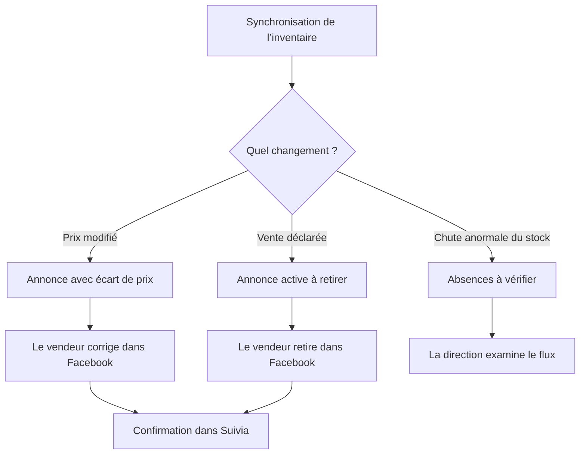

<p align="center">
  <a href="https://suivia.ca"></a>
</p>

<h1 align="center">Le centre de publication Marketplace pour les concessions</h1>

<p align="center">Quel véhicule publier aujourd’hui ? Quel prix corriger ? Quelle annonce retirer après une vente ?<br>Suivia Auto relie chaque annonce à sa fiche d’inventaire et au membre de l’équipe qui l’a publiée.</p>

<p align="center">
  <a href="https://suivia.ca"><strong>Ouvrir Suivia Auto</strong></a> ·
  <a href="https://suivia.ca/demande-acces">Demander un accès</a> ·
  <a href="GUIDE_DEMARRAGE.md">Guide vendeur</a> ·
  <a href="#démarrage-local">Démarrage local</a>
</p>

> [!NOTE]
> La vidéo publicitaire, la file **À corriger** et les améliorations de retrait décrites ici font partie de la [PR #18](https://github.com/mboyer1269-pixel/OKauto/pull/18). Pour connaître la version en service, consultez le champ `version` sur [suivia.ca/api/health](https://suivia.ca/api/health).

## Une matinée au département des ventes

Ouvrez **Vue du matin** pour vérifier la dernière synchronisation et le quota disponible. Dans **Publications**, commencez par les annonces qui pourraient faire déplacer un acheteur pour un véhicule vendu ou lui présenter le mauvais prix.

| Dans Suivia | Ce que vous cherchez | Votre prochaine action |
| :--- | :--- | :--- |
| **À retirer** | Un véhicule vendu dont l’annonce est encore en ligne | Ouvrir l’annonce Facebook, la retirer, puis confirmer le retrait dans Suivia. |
| **À corriger** | Un écart entre le prix en inventaire et celui de votre annonce | Corriger le prix dans Facebook, puis cliquer sur **J’ai mis le prix à jour dans Facebook**. |
| **Aujourd’hui · À préparer** | Un véhicule à mettre de l’avant | Vérifier le prix, le kilométrage, le stock, le NIV et les photos. Préparer le texte et, au besoin, une vidéo. |
| **Publiées · À renouveler** | Une annonce déjà en circulation | Ouvrir le lien enregistré. Lorsque le renouvellement est dû, le faire dans Facebook et le confirmer dans Suivia. |

### Du changement de stock à l’action du vendeur



Une synchronisation partielle conserve le compteur d’absence des véhicules manquants. Une vente déclarée deux fois en même temps compte une seule fois et déclenche une seule alerte au vendeur dans le scénario testé. Un rappel cible les annonces qui attendent toujours leur retrait après 24 heures. [Tests de synchronisation](apps/worker/src/__tests__/sync.test.ts)

## Créer une vidéo avec les photos d’un véhicule

**Inventaire → fiche d’un véhicule disponible → Créer la vidéo → Aperçu → Télécharger la vidéo**

| Format | Photos | Durée | Contenu |
| :--- | :--- | :--- | :--- |
| Vertical **9:16**, 720 × 1280 | Jusqu’aux **6 premières** de la fiche | **6 à 15 secondes** selon les photos utilisables | Nom du véhicule et invitation « Écrivez-nous pour un essai » |

Le montage se fait dans le navigateur. Gardez l’onglet visible jusqu’à l’aperçu, puis téléchargez la vidéo en **MP4 ou WebM**, selon le navigateur. Vous choisissez ensuite où la publier.

Si une photo est illisible, Suivia indique combien il en a omis et utilise les autres. Si le nouvel export échoue ou est annulé, le dernier montage réussi reste téléchargeable **tant que la même fiche reste ouverte**. [Test du parcours vidéo dans Chromium](apps/web/e2e/vehicle-video.spec.ts)

## Publier et suivre une annonce

1. **Préparer.** Trouvez le véhicule par stock ou par NIV. Vérifiez les renseignements de la fiche et relisez la description.
2. **Publier.** L’extension Chrome préremplit le formulaire Marketplace. Le mode rapide permet aussi de copier le texte et de télécharger la photo. Le vendeur vérifie le formulaire et clique sur **Publier** dans Facebook.
3. **Relier.** Si l’extension n’a pas enregistré le lien, copiez l’URL Facebook contenant `/marketplace/item/` et choisissez **Marquer comme publiée** dans Suivia. Ce lien permet de retrouver la bonne annonce quand le prix ou le statut change.

<details>
<summary><strong>Installer l’extension Chrome</strong></summary>

À la racine du dépôt, exécutez `pnpm --filter @okauto/extension build`. Dans `chrome://extensions`, activez le mode développeur et chargez le dossier `apps/extension/dist`.

Dans **Mon extension**, créez une clé pour cet ordinateur et copiez-la dès sa création. Dans les **Réglages** de l’extension, entrez l’adresse de Suivia et la clé, puis choisissez **Enregistrer et connecter**. Après une mise à jour, rechargez l’extension et actualisez l’onglet Suivia. [Manifeste Chrome](apps/extension/public/manifest.json)

</details>

<details>
<summary><strong>Inventaire, catalogue Meta et accès de l’équipe</strong></summary>

| Fonction | Utilisation |
| :--- | :--- |
| Inventaire | Saisie manuelle, import CSV ou synchronisation planifiée. Les adaptateurs prennent en charge les flux JSON, les pages JSON-LD et les sites D2C. |
| Décodage du NIV | Le service vPIC complète les champs manquants. Les données saisies par la concession ont priorité. |
| Descriptions et photos | Modèle de texte intégré, descriptions avec OpenAI si une clé est configurée, photos par URL ou téléversement S3. |
| Catalogue Meta | Dans **Paramètres**, activez le flux CSV et ajoutez son URL au Commerce Manager. Les campagnes publicitaires se gèrent dans Meta. |
| Direction | Suivi des publications de l’équipe, des renouvellements et des véhicules en stock depuis longtemps. |
| Accès | Les demandes publiques sont traitées par les administrateurs de plateforme. Les invitations de concession utilisent un lien à usage unique valable sept jours. |

</details>

## Démarrage local

Depuis la racine du dépôt, utilisez **Node.js 22**, **pnpm 9.15.2** et **Docker Compose**. Sous Windows, installez aussi Git Bash, que le lanceur appelle depuis PowerShell.

```powershell
pnpm start:local
```

Le lanceur prépare le fichier `.env`, démarre PostgreSQL et Redis, initialise la base de développement, construit l’extension et lance le site et le worker. Ouvrez [localhost:3000](http://localhost:3000) et utilisez le compte de démonstration affiché dans le terminal. [Script de démarrage](scripts/start.sh)

## Repères techniques

| Composant | Responsabilité |
| :--- | :--- |
| [Application web](apps/web) | Next.js App Router, tableau de bord, API et montage vidéo dans le navigateur |
| [Extension Chrome](apps/extension) | Préremplissage et liaison des annonces Marketplace |
| [Worker](apps/worker) | Files BullMQ sur Redis pour la synchronisation, le décodage des NIV et les rappels |
| [Base de données](packages/database) | PostgreSQL et Prisma pour l’inventaire, les annonces et leur historique |
| [Logique partagée](packages/shared) | Adaptateurs de flux, règles de publication, prix et descriptions |

<details>
<summary><strong>Commandes de validation</strong></summary>

```powershell
pnpm db:generate
pnpm typecheck
pnpm lint
pnpm test:unit
pnpm test:int
pnpm --filter @okauto/web test:e2e
```

Utilisez une base de test et Redis pour l’intégration. Les contrôles GitHub vérifient aussi les migrations, la construction des images web et worker, leur démarrage et le parcours navigateur. [Configuration CI](.github/workflows/ci.yml)

</details>

<details>
<summary><strong>Configuration, déploiement et récupération</strong></summary>

| Besoin | Référence |
| :--- | :--- |
| Paramétrer l’application et les services optionnels | [Exemple local](.env.example) · [Configuration du VPS](deploy/README.md) |
| Déployer une version | La CI sur `main` précède la publication des images sur GHCR. Le workflow de déploiement utilise l’environnement GitHub `production` et le SHA de version. [Workflow Deploy](.github/workflows/deploy.yml) |
| Vérifier la mise en service | [Santé et version du site](https://suivia.ca/api/health) · [Disponibilité de PostgreSQL, Redis et du worker](https://suivia.ca/api/health/ready) |
| Diagnostiquer une panne, revenir à une version ou restaurer la base | [Procédures d’exploitation](deploy/RUNBOOK.md) · [Configuration des sauvegardes](deploy/backup.env.example) |
| Modifier le schéma ou les éléments visuels | [Guide des migrations](packages/database/prisma/MIGRATIONS.md) · [Identité visuelle Suivia](apps/web/src/brand/README.md) |

</details>

---

Suivia Auto © 2026 · Logiciel propriétaire. Le dépôt, les paquets `@okauto/*` et le chemin VPS `/opt/okauto` conservent le nom historique **OKauto**.
